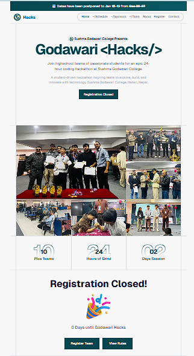

# Godawari Hacks



The website and registration portal for **Godawari Hacks**, a 24-hour highschool
hackathon at Sushma Godawari College, Itahari, Nepal.

## Stack

| Layer | Choice |
| --- | --- |
| Framework | Next.js 16 (App Router, Turbopack) |
| Content | Sanity v5 — embedded Studio at `/studio` |
| Registrations | Sanity (`teamRegistration` documents) |
| Admin auth | Supabase Auth + `admin_users` table |
| Styling | Tailwind CSS 3, Geist font |
| Mail | Nodemailer (Gmail SMTP) |
| Package manager | pnpm |
| Hosting | Vercel |

## Getting started

```bash
pnpm install
cp .env.example .env     # then fill in the values below
pnpm dev
```

The site runs at `http://localhost:3000`, the Studio at `/studio`.

### Environment variables

| Variable | Used for |
| --- | --- |
| `NEXT_PUBLIC_SANITY_PROJECT_ID` | Sanity project |
| `NEXT_PUBLIC_SANITY_DATASET` | Sanity dataset (`production`) |
| `SANITY_WRITE_TOKEN` | Server-side writes: registrations, imports |
| `SANITY_WEBHOOK_SECRET` | Verifies the registration-status webhook |
| `NEXT_PUBLIC_SUPABASE_URL` | Supabase project URL |
| `NEXT_PUBLIC_SUPABASE_ANON_KEY` | Supabase client key |
| `SUPABASE_SERVICE_ROLE_KEY` | Server-side Supabase access |
| `SMTP_USER` / `SMTP_PASSWORD` | Outgoing mail |
| `CLOUDFLARE_TURNSTILE_SECRET_KEY` | Verifies registration captcha |
| `NEXT_PUBLIC_CLOUDFLARE_TURNSTILE_SITE_KEY` | Captcha widget |

> `NEXT_PUBLIC_SUPABASE_URL` must be the project **URL** and
> `SUPABASE_SERVICE_ROLE_KEY` the **JWT**. These were swapped at one point,
> which silently broke every Supabase call — `next.config.mjs` swallows the
> resulting `new URL()` failure in an empty `catch`.

## Project structure

```text
app/
├── archive/          Photo archive (masonry grid + lightbox)
├── blog/             Blog index and post pages
├── admin/            Supabase-authenticated dashboard (legacy, see below)
├── api/
│   ├── register/     Registration intake → writes to Sanity
│   ├── sanity/       Webhook receiver for status-change emails
│   └── admin/        Legacy Supabase admin endpoints
├── components/       Shared UI
└── data/             Static site metadata

sanity/
├── schemaTypes/
│   ├── documents/    Multi-instance types (blogPost, archivePhoto, …)
│   ├── singletons/   One-off documents (homePage, siteSettings)
│   └── objects/      Embedded types; objects/home/ holds homepage sections
├── lib/              Client, queries, image/portable-text helpers, seasons
├── migrations/       One-time data imports
└── structure.ts      Studio sidebar layout

scripts/              Photo-curation tooling (see Archive below)
proxy.ts              Next.js 16 proxy (formerly middleware.ts)
```

## Content model

Content is edited in the Studio at `/studio`. Documents are grouped by **season**
— a plain year string. [`sanity/lib/seasons.ts`](sanity/lib/seasons.ts) is the
single source of truth:

```ts
export const SEASONS = ['2027', '2026'] as const
export const CURRENT_SEASON = '2027'
```

To open a new season, bump `CURRENT_SEASON` and add the year to `SEASONS`.
The schema options, Studio structure and registration intake all follow.

### Registrations

Teams submit at `/register`; the route uploads the payment screenshot and each
member's ID document to Sanity, then creates one `teamRegistration` document
with members embedded. Every asset uploads *before* the document is created, so
a failed upload cannot leave a half-populated registration.

Review them in the Studio under **Registrations → Season → Pending/Approved/…**

Changing a registration's `status` fires a Sanity webhook that emails every team
member. Configure it at [sanity.io/manage](https://www.sanity.io/manage) → API →
Webhooks:

| Field | Value |
| --- | --- |
| URL | `https://<domain>/api/sanity/registration-status` |
| Trigger | Update · POST |
| Filter | `_type == "teamRegistration" && delta::changedAny(status)` |
| Projection | `{teamName, status, "members": members[]{fullName, email}}` |
| Secret | must match `SANITY_WEBHOOK_SECRET` |

> **Uploaded ID documents are publicly reachable.** Sanity dataset assets are
> served from the asset CDN even when the dataset is private — a private dataset
> only stops unauthenticated users *discovering* the URL. Anyone holding a URL
> can fetch the file. Treat registrant documents accordingly.

### Archive

`/archive` renders `archivePhoto` documents for a season as a masonry grid with
a keyboard-navigable lightbox (`←` `→` `Esc`).

The 2026 set was curated from 294 raw photos down to 156:

1. `scripts/make-thumbs.mjs` — downscales originals for review
2. `scripts/dedupe-scan.mjs` — groups near-duplicates by dHash (294 → 165 scenes)
3. `scripts/pick-representatives.mjs` — picks the sharpest frame per cluster
4. Every representative was reviewed by eye; 9 were dropped — a bank payment
   receipt, two photos from an unrelated industrial visit, two candid shots of
   people sleeping, a screen capture, a design graphic, an empty frame and one
   unusable blur.

The result, with per-photo alt text and captions, is committed at
[`sanity/migrations/data/archive-2026-photos.json`](sanity/migrations/data/archive-2026-photos.json)
so the import is reproducible:

```bash
# dry run
npx tsx --env-file=.env --env-file=.env.local \
  sanity/migrations/import-archive-photos.ts
# write
... --commit
```

Re-runs skip anything already imported, keyed on `originalFilename`.

## Migrations

All live in `sanity/migrations/`, all dry-run by default and need `--commit`:

| Script | Purpose |
| --- | --- |
| `import-archive-photos.ts` | Curated event photos → `archivePhoto` |
| `import-registrations-from-supabase.ts` | Legacy Supabase teams → `teamRegistration` |
| `move-sections-into-homepage.ts` | Folds standalone sections into `homePage` |

## SEO

- Per-page `title`, `description` and `canonical`; the root layout sets only
  `metadataBase` and defaults. **Do not put a canonical in the root layout** —
  it is inherited and makes every page look like a duplicate of the homepage.
- `Organization` JSON-LD site-wide, `Event` on the homepage, `Blog` on the blog
  index, `BlogPosting` on posts, `ImageGallery` on the archive.
- `app/sitemap.ts` lists static routes plus every blog post;
  `app/robots.ts` blocks `/studio`, `/admin` and `/api`.
- Decorative images intentionally use `alt=""` so screen readers skip them.

## Known issues

- **Dark mode never activates.** Tailwind is configured with `darkMode: "class"`,
  but `ThemeToggle.tsx` is the only code that adds the class and it is not
  rendered anywhere. Every `dark:` utility in the codebase is currently inert.
- **`/rules` does not exist** but is linked from the footer, and the "View Rules"
  button in `RegisterSection.tsx` points at a `#rules` anchor that is never rendered.
- **The admin dashboard is legacy.** `/admin` and `/api/admin` still read teams
  from Supabase, which no longer receives registrations. The Studio is the live
  admin surface.
- `pnpm lint` reports 7 pre-existing `react-hooks` errors, including a
  `setState` inside an effect in `app/register/page.tsx` that lists its own
  state in the dependency array.
- `ApologyBanner.tsx`, `ThemeToggle.tsx` and `HeroEffect.tsx` are unreferenced.

---

Made for **Godawari Hacks 2026** by Manish Gole Tamang
